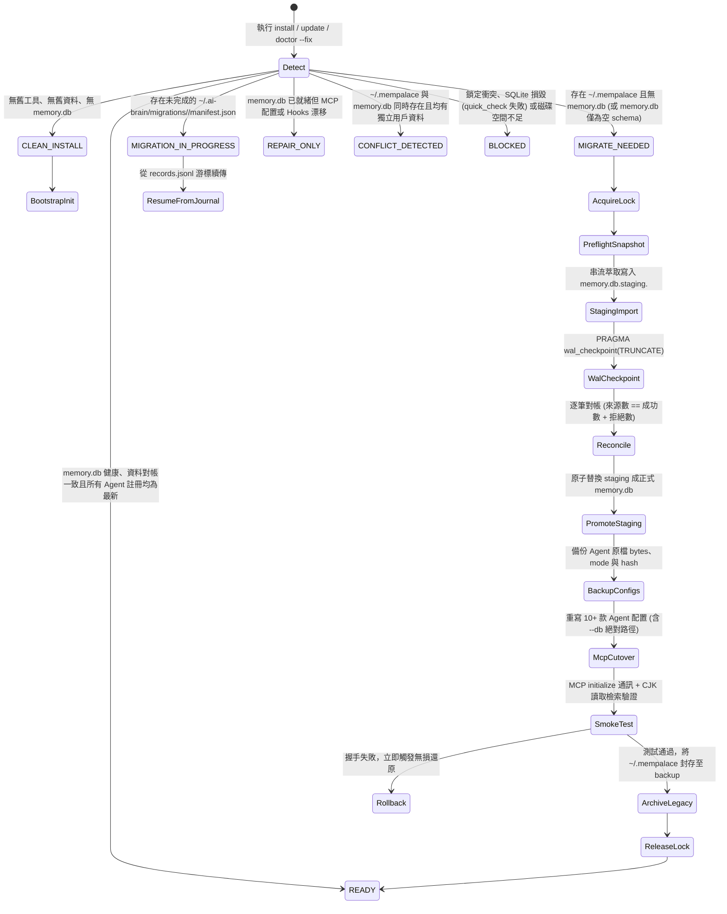

# 系統重構升級計畫：全面遷移至 ai-memory 獨立本機架構
*(經 Claude、Codex、Kimi 三輪聯合深度架構審查與收斂定稿版)*

本計畫落實核心架構升級決策，將現行雙軌記憶（`claude-mem` + `mempalace`）全面整併為高效能、支援離線與單機零依賴的 **`ai-memory` (SQLite + FTS5)** 獨立本機模式，並整合 Claude、Codex 與 Kimi 三輪審閱之最高規格生產級防護：
* **官方契約先行**：`ai-memory schema-init` 官方 DDL 初始化先行，鎖定 `schema_version` (v81) 後再行純資料批次灌入。
* **EAV 串流與批次交易**：ChromaDB EAV SQL Join 串流萃取，配合 `executemany()` 批次交易 (`chunk_size=500`)，以 `PRAGMA wal_checkpoint(TRUNCATE)` 確保磁碟確定性。
* **零依賴中文檢索**：CJK Bi-gram 標籤生成（摘要區段限額 50 個）+ 查詢端展開與 <=2 字 `LIKE` fallback，不魔改上游虛擬表。
* **短命 L0 遙測退役**：`claude-mem` 正式定調為短期遙測不遷入，30 天唯讀保留封存，清理進程、Hooks 與提示詞指引。
* **Durable Journal 回滾**：`manifest.json` + `records.jsonl` 存於獨立目錄 (`0700`/`0600`)，Staging 隔離提升，同目錄原子替換防止 `EXDEV`，漂移衝突保護。
* **四環境完全隔離沙盒**：`local`、`minipc`、`devpc`、`fqipc` 雙層環境隔離與零實體資料觸碰斷言。

---

## 1. 核心狀態機與生命週期 (Architecture & State Machine)

### 1.1 精確環境狀態機 (Environment Detection State Machine)
避免粗糙判定造成資料覆寫或中斷，定義七態環境流轉：



### 1.2 狀態判定準則 (State Precedence Rules)
1. **`BLOCKED`**：存在活躍進程鎖（Migration File Lock 取得失敗）、磁碟可用空間 < 舊資料庫 1.5 倍、或 SQLite `PRAGMA quick_check` 失敗。
2. **`MIGRATION_IN_PROGRESS`**：目錄 `~/.ai-brain/migrations/` 下存在狀態為非 `COMPLETED` / `ROLLED_BACK` 之 `manifest.json`，比對 `migration_id` 與來源指紋後自 checkpoint 續傳。
3. **`CONFLICT_DETECTED`**：`~/.ai-memory/memory.db` 存在且 `SELECT COUNT(*) FROM memories > 0`，且 `~/.mempalace` 亦存在抽屜資料，且無關聯之未完成 manifest。需要使用者明確確認合併策略，嚴禁自動覆蓋。
4. **`MIGRATE_NEEDED`**：`~/.mempalace` 存在，且 `~/.ai-memory/memory.db` 不存在（或記憶筆數為 0，且血緣標記為 schema-only）。
5. **`REPAIR_ONLY`**：`memory.db` 存在且健康，但檢測到有已安裝之 IDE 遺漏 `ai-memory` MCP 註冊或殘留舊 Hooks。
6. **`CLEAN_INSTALL`**：環境為純淨狀態，無舊庫亦無新庫。
7. **`READY`**：記憶庫存在健康，對帳清單存在且無配置漂移。

---

## 2. 三輪審查收斂技術規範 (Converged Technical Specifications)

### 2.1 上游 Schema 初始化契約 (`alphaonedev/ai-memory-mcp`)
* **上游合約依據**：上游採用 Rust 單一二進制，透過 `schema_version` 管理 81 道遷移與 CHECK constraints 觸發器。
* **嚴禁行為**：嚴禁由 Python 手動建立 `CREATE TABLE memories` 或偽造 `schema_version`。
* **標準初始化流程**：
  1. Python 透過 `subprocess.run` 執行上游官方指令：
     ```bash
     ai-memory schema-init --store-url sqlite://{pathname2url(str(staging_db_path))} --json
     ```
  2. 若二進制未編譯 `sal` feature，則透過輕量安全探測啟動：
     ```bash
     ai-memory --db {staging_db_path} stats
     ```
  3. Python 端連接 staging 庫驗證表結構：
     ```sql
     SELECT MAX(version) FROM schema_version; -- 必須 >= 81
     SELECT name FROM sqlite_master WHERE type='table' AND name IN ('memories', 'memories_fts');
     ```

### 2.2 ChromaDB EAV 串流萃取與交易式批次寫入
* **EAV SQL 萃取查詢**：
  ```sql
  SELECT 
      e.embedding_id AS drawer_id,
      m_doc.string_value AS content,
      COALESCE(m_wing.string_value, 'general') AS wing,
      COALESCE(m_room.string_value, 'default') AS room,
      m_file.string_value AS source_file,
      m_topic.string_value AS topic,
      m_date.string_value AS filed_at
  FROM embeddings e
  INNER JOIN embedding_metadata m_doc 
      ON e.id = m_doc.id AND m_doc.key = 'chroma:document'
  LEFT JOIN embedding_metadata m_wing 
      ON e.id = m_wing.id AND m_wing.key = 'wing'
  LEFT JOIN embedding_metadata m_room 
      ON e.id = m_room.id AND m_room.key = 'room'
  LEFT JOIN embedding_metadata m_file 
      ON e.id = m_file.id AND m_file.key = 'source_file'
  LEFT JOIN embedding_metadata m_topic 
      ON e.id = m_topic.id AND m_topic.key = 'topic'
  LEFT JOIN embedding_metadata m_date 
      ON e.id = m_date.id AND m_date.key = 'filed_at';
  ```
* **資料欄位映射 (Contract Mapping)**：
  * `id`: `str(uuid.uuid5(uuid.NAMESPACE_URL, f"mempalace:{drawer_id}"))` (保證冪等性)
  * `tier`: `"long"`
  * `namespace`: `"default"`
  * `title`: `(topic.strip() if topic else content[:60].strip()) or "Untitled Drawer"`
  * `content`: 原始 markdown 內文
  * `tags`: JSON array 字串（含 wing, room 及 CJK Bi-gram 標籤）
  * `metadata`: JSON object 字串，儲存 `{"source": "mempalace", "drawer_id": drawer_id, "wing": wing, "room": room, "source_file": source_file, "filed_at": filed_at}`
  * `created_at` / `updated_at`: `filed_at` 或當前 UTC ISO-8601
* **批次寫入與參數安全**：
  * 使用 Python Generator 分塊，固定 `chunk_size = 500`。
  * **嚴禁**展開成巨型 `VALUES (?, ...), (?, ...)`，避免撞上 SQLite 參數個數上限（SQLite < 3.32 上限為 999）。
  * 採用 `BEGIN IMMEDIATE` + `cursor.executemany("INSERT INTO memories (...) VALUES (?, ?, ...)", chunk)` + `COMMIT`。
  * 批次結束後執行 `PRAGMA wal_checkpoint(TRUNCATE)`，消除 WAL 滯留頁面，確保主庫檔案雜湊確定性。

### 2.3 中文 FTS5 檢索相容與 CJK Bi-gram 膨脹防護
* **問題**：上游 `memories_fts` 虛擬表預設使用 `unicode61`，對中文無分詞能力。
* **零依賴解決架構**：
  1. **提取範圍與限額**：僅自 `title`、`topic` 以及內文前 200 字與後 200 字提取中文 Bi-gram，單筆抽屜之 CJK 標籤上限嚴格截斷為 **50 個**，過濾無意義虛詞。
  2. **標籤格式**：寫入 `tags` 陣列，前綴為 `cjk:<token>`（例如 `cjk:架構`, `cjk:遷移`）。
  3. **查詢展開**：CLI 或 MCP 查詢時，若包含中文，自動將詞彙切分為 Bi-gram 進行標籤精確匹配（`WHERE EXISTS (SELECT 1 FROM json_each(tags) WHERE value = ?)`）。
  4. **短字 Fallback**：針對 1~2 字之極短查詢，以 `SELECT ... FROM memories WHERE content LIKE '%term%' LIMIT 20` 進行保護性補償。
  5. **上游相容**：不更動上游虛擬表結構，確保未來二進制無損升級。

### 2.4 claude-mem 短期遙測退役政策
* **定調**：`claude-mem` 定位為 L0 Ephemeral Session Telemetry，不遷入 L2 永久記憶庫。
* **退役執行細則**：
  1. 終止背景 worker 進程（終止 PID，並檢查 lockfile 釋放）。
  2. 移除 `~/.claude/settings.json` 與所有遠端 `*_settings.json` 中的 `preCompact` 與 `onStop` 鉤子，以及 plugin 載入項。
  3. 更新 `constants.py` 中的 `COGNITIVE_PRINCIPLES_BLOCK`，刪除對 `claude-mem` 之引用。
  4. 使用 Python `tarfile` 將 `~/.claude-mem` 壓縮封存為 `~/.claude-mem.backup.<timestamp>.tar.gz`（跳過 socket 檔案），保留 30 天唯讀觀察期，嚴禁立即物理刪除。

### 2.5 交易式 Durable Journal 與無損回滾機制
* **目錄結構與安全權限**：
  * 目錄：`~/.ai-brain/migrations/<migration_id>/`（權限強制 `0o700`）
  * 檔案：`manifest.json`、`records.jsonl`（權限強制 `0o600`）
* **Manifest 核心結構**：
  ```json
  {
    "manifest_version": 1,
    "migration_id": "01J...",
    "state": "STAGING_DONE",
    "created_at": "2026-11-05T00:00:00Z",
    "updated_at": "2026-11-05T00:00:00Z",
    "ai_brain_version": "2.8.3",
    "source": {
      "kind": "mempalace",
      "path": "~/.mempalace",
      "fingerprint_sha256": "...",
      "drawer_count": 8439
    },
    "target": {
      "staging_db": "memory.db.staging.01J...",
      "final_db": "memory.db",
      "pre_existed": false,
      "schema_version": 81
    },
    "reconciliation": {
      "source_total": 8439,
      "imported": 8439,
      "rejected": 0,
      "ledger_file": "records.jsonl"
    },
    "config_backups": [
      {
        "target_path": "/Users/carlos/.claude.json",
        "backup_path": "backups/claude.json",
        "existed": true,
        "mode": "0600",
        "before_sha256": "...",
        "after_cutover_sha256": "..."
      }
    ]
  }
  ```
* **跨磁碟分割、血緣狀態與漂移防護實作**：
  * **目標庫回滾血緣保護**：若回滾發生於 `PromoteStaging` 之後，依據 manifest 之 `target.pre_existed` 標記：若遷移前無 `memory.db`，則回滾時將 `memory.db` 原子移除或移至 `.rolled_back`，防止殘留資料庫導致重跑時被誤判為 `CONFLICT_DETECTED`。
  * **防止 `EXDEV`**：暫存檔案建立於目標目錄同級之 `.tmp_<name>.<uuid>`，確保 `os.replace()` 為同一 mount point 的原子調用。
  * **漂移衝突保護**：回滾時，若目標現存檔案雜湊不等於 `after_cutover_sha256`，代表被外部人工編輯，先備份為 `.conflict.<timestamp>`，再執行還原。

### 2.6 多 IDE 配置格式與絕對路徑相容性
* 所有 MCP 配置必須強制綁定 `--db` 絕對路徑：`["--db", str(Path.home() / ".ai-memory" / "memory.db"), "mcp"]`。
* **各 Agent 格式標準**：
  * **OpenCode / Kilo CLI**：命令必須為陣列 `["ai-memory", "--db", "...", "mcp"]`。
  * **Claude Desktop**：禁止包含 `"type": "stdio"`（否則拒絕載入）。
  * **Claude Code / Gemini / Cursor / OMP**：標準物件 `{"type": "stdio", "command": "ai-memory", "args": [...]}`。
  * **Codex**：`config.toml` 之 TOML 表格 `[mcp_servers.ai-memory]`。
  * **遠端 SSH Claude**：自動列舉並校準 `~/.claude/*_settings.json`。

---

## 3. 四大環境 Profile 測試矩陣 (Zero Real Data Touch)

> [!CAUTION]
> **絕對安全保證：嚴禁接觸實體 PC 真實資料**
> 所有開發測試**100% 於暫存沙盒（`InTempDir`）中執行**。環境變數 `HOME`、`XDG_CONFIG_HOME`、`XDG_DATA_HOME` 與 `Path.home()` 全部指向 tempdir，測試結束自動銷毀，並具備子行程隔離保護。

### 3.1 四大環境統一越界攔截斷言 (Unified Zero-Touch Assertion)
在四大 Profile 的 `tearDown` 與驗證環節中，全面實施三大邊界防護斷言：
1. **實體路徑不變性斷言**：檢查實體主機真實路徑（`~/.mempalace`、`~/.ai-memory`、`~/.claude`），斷言其存在性、檔案數量與修改時間在測試前後 100% 保持未修改。
2. **子行程環境無洩漏斷言**：所有被 mock 呼叫之子行程與 runner 傳入的 `env` 字典，斷言 `HOME` 與 `XDG_*` 嚴格限制於 tempdir 內部，嚴禁繼承實體用戶家目錄。
3. **無硬編碼路徑掃描斷言**：遍歷 tempdir 下產生的所有 JSON/TOML 設定檔與 manifest，斷言不存在未沙盒化的實體路徑（如 `/Users/carlos` 或 `/home/carlos` 洩漏至其他環境）。

### 3.2 環境模擬設定表
| 測試基準 Profile | 模擬環境與平台標記 | 初始沙盒配置 | 驗證項目 |
| :--- | :--- | :--- | :--- |
| **`local` (MacBook)** | Darwin (`/Users/carlos`) | 預置 mock EAV `chroma.sqlite3` (含 10+ 筆抽屜) + 舊 MCP 設定 | 驗證完整遷移、對帳一致、Staging 提升、MCP 切換、SmokeTest 通訊。 |
| **`minipc` (Mac mini)** | Darwin (`/Users/carlos`) | 空白沙盒：無任何舊工具與舊目錄 | 驗證全新安裝分支，呼叫 schema-init，不觸發遷移與備份。 |
| **`devpc` (Linux 標準)** | Linux (`/home/carlos`) | Mock `platform.system() == "Linux"`，POSIX 路徑 | 驗證 Linux 路徑 (`~/.config`)、略過 Claude Desktop、權限 `0o700`/`0o600`。 |
| **`fqipc` (Linux 特殊用戶)** | Linux (`/home/brian`) | 模擬非標準使用者 `brian` + `46.224.196.164_settings.json` | 驗證路徑動態計算無 hardcode，遠端設定檔自動列舉與校準，零硬編碼洩漏斷言。 |

---

## 4. 驗證與測試計畫 (Verification Plan)

### 自動化測試指令
```bash
# 1. 執行四大環境測試矩陣 (包含 EAV 萃取、交易寫入、切換與回滾)
uv run pytest tests/test_migration_profiles.py -v

# 2. 執行全量單元與整合測試
uv run pytest -q

# 3. 程式碼靜態品質檢查
uv run ruff check src/ tests/
```
